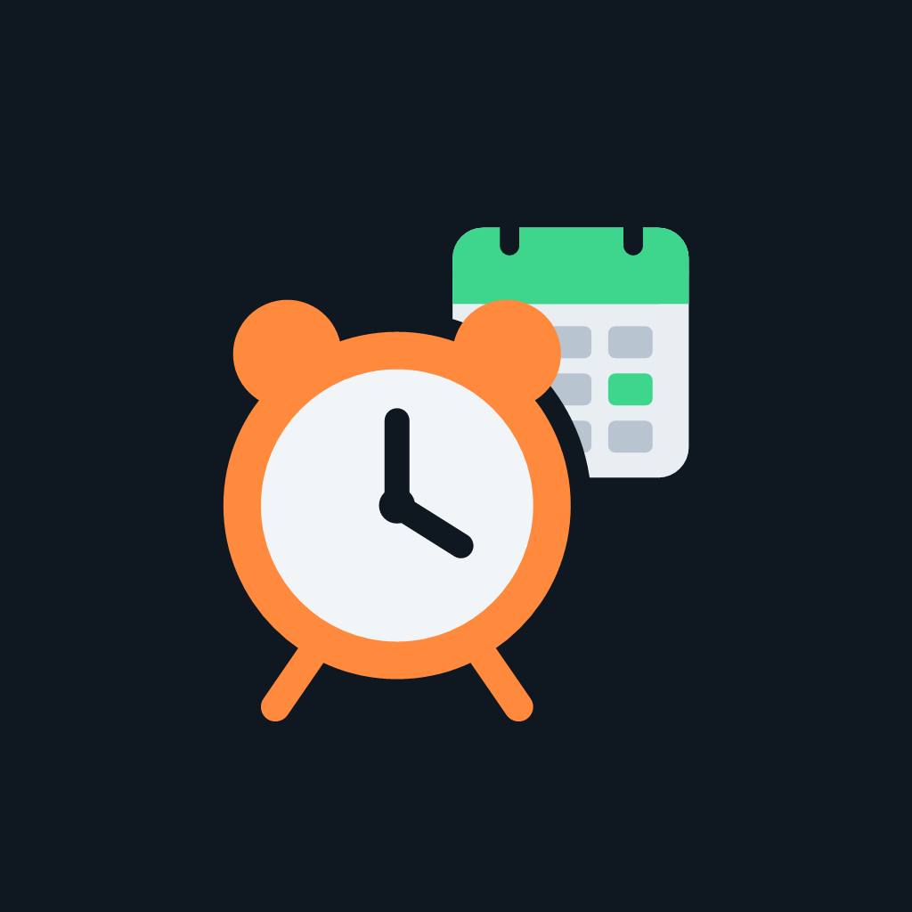

<p align="center">
  
</p>

<h1 align="center">Better Alarms</h1>

<p align="center">
  An Android alarm clock for shift workers.<br />
  Your alarms follow your work schedule, so you never have to set them by hand again.
</p>

<p align="center">
  <a href="../../releases/latest"><b>Download the latest APK</b></a>
</p>

---

Regular alarm apps only know "every weekday" or "every Monday". Shift work doesn't fit that. Better Alarms reads your work calendar or learns your rotation, and rings only on the days you work. If your schedule changes, your alarms change with it.

It's also a complete replacement for the built-in Clock app, with everyday alarms, timers, a stopwatch and a world clock.

## Features

### Alarms that follow your work schedule

- **From your calendar.** Pick a word that appears in your shift events (like "Work"). The app rings a set time before each shift starts. Move a shift in Google Calendar and the alarm moves too. No Google sign-in is needed, because the app reads the calendar already synced to your phone.
- **Multi-day shifts.** One event covering "Fri 6:30 AM – Sun 6:45 PM" counts as a shift on Friday, Saturday and Sunday. An overnight shift like "10 PM – 6 AM" counts as one shift.
- **Any rotation.** Build a repeating on/off cycle of up to 56 days, or pick a preset: 2-2-3 (Panama), 2/2, 3/3, 4/4, 4/3 or 5/2. It repeats until you turn it off.
- **Keeps your pattern going.** If your calendar only has shifts up to the end of the month, the app spots the cycle behind them and keeps ringing on it afterwards.
- **Days off.** A calendar event with a word like "Vacation" or "PTO" silences your alarms that day.
- **Holidays.** When a work alarm lands on a holiday, the app asks whether you're working and sends a reminder a week ahead. If you don't answer, the alarm still rings. US federal holidays are built in, and any holiday calendar on your phone is picked up too.
- **Month view.** See every work day and alarm time for any month, skip a single day, or add an alarm on a specific date.

### A full clock app

- **Everyday alarms.** One-time or repeating alarms, set from the + button, just like the stock clock.
- **Timers.** Several at once, with pause, +1 minute and reset. They keep running with the app closed and show a live countdown in your notifications.
- **Stopwatch** with laps.
- **World clock** for about 70 cities, showing how far ahead or behind each one is.
- **Works with your phone.** Answers Android's standard "set an alarm" and "set a timer" requests from voice assistants and other apps.

### Make sure you're actually awake

- **Wake-up challenges.** Require a math problem, a typed code or a traced pattern to turn the alarm off. Snoozing never needs one.
- **Backup alarm.** Rings once more a few minutes after you turn the alarm off, in case you did it in your sleep. Tap "I'm up" on the notification to cancel it.
- **Sound.** Choose any alarm sound on your phone, have it start quiet and get louder over 30 seconds, and turn vibration on or off.
- **Separate timer settings.** Timers have their own sound, vibration and turn-off challenge, separate from alarms.
- **Reliable.** Alarms use the same Android alarm system as the built-in Clock app. They ring with the app closed, in battery-saver mode and after a restart, and they show over the lock screen.

## Install

1. On your Android phone, download the APK from the [latest release](../../releases/latest).
2. Open it. If Android asks, allow your browser or file manager to install unknown apps.
3. Open Better Alarms and tap **Fix it** to grant the permissions it needs.
4. Tap **My shifts are in my calendar** or **I work a repeating pattern**, or add an everyday alarm with **+**.
5. In **Sounds & wake-up**, tap **Test alarm in 10 seconds**, then lock your phone to see the real thing.

Requires Android 7.0 or newer. Tested on Android 16.

### Permissions

| Permission | Why |
| --- | --- |
| Notifications | Shows the ringing alarm, timers and holiday questions |
| Alarms & reminders (exact alarms) | Rings on the exact minute, even in battery-saver mode |
| Full-screen notifications | Shows the alarm over the lock screen |
| Calendar | Finds your shifts, days off and holidays (it reads your events and never changes them) |
| Run at startup | Sets your alarms again after the phone restarts |

**Privacy:** everything stays on your phone. The app has no accounts, servers, ads or analytics, and your calendar is read on the device.

## How it works

The app works out the next 14 days of alarms (you can change this to 7 or 30) and hands them to Android's alarm system ahead of time. It refreshes them whenever you open the app, change something, or Android runs its periodic background task. That means alarms still ring even if the app hasn't been opened in a while.

If the calendar can't be read during a refresh, the alarms already set are kept rather than cleared. A missed alarm is worse than an extra one.

### Project structure

| Path | What's there |
| --- | --- |
| `src/logic/` | Pure JavaScript scheduling rules: rotations, multi-day shifts, pattern detection, holidays, world clock. Unit tested. |
| `src/app/` | Screens, using [Expo Router](https://docs.expo.dev/router/introduction/) with a side menu |
| `src/state/app-store.js` | Shared app state and actions |
| `src/services/` | Calendar access, alarm sync, background refresh, storage |
| `modules/alarm-engine/` | Native Android module in Kotlin: `AlarmManager.setAlarmClock`, the ringing service, the lock-screen alarm screen with wake-up challenges, timers, backup alarms, restart handling, Clock-app intents |
| `plugins/` | Expo config plugins: Clock-app intent filters, plus a fix for local Windows builds |
| `tests/` | Node test runner tests for `src/logic/` |

Built with [Expo](https://expo.dev) (SDK 58) and React Native, in JavaScript.

## Development

You need Node 20+, plus Java 17 and the Android SDK for local native builds. You can skip those and build in the cloud with [EAS](https://docs.expo.dev/build/introduction/) instead.

```sh
npm install
npm test          # scheduling logic tests
npx expo lint
```

Run on a phone connected over USB:

```sh
# Installs as "Better Alarms (dev)", next to a release install
APP_VARIANT=development npx expo run:android
```

On Windows, set the variable with `$env:APP_VARIANT = 'development'` in PowerShell. Native C++ build folders go under `C:\bacx` and use CMake 3.31.6 (see `plugins/with-short-cmake-paths.js`), because the default locations exceed Windows' 260-character path limit.

The app uses a custom native module, so it won't run in Expo Go. The screens will open there, but alarms won't ring.

### Release build

```sh
npm run build:apk   # eas build --platform android --profile preview
```

## Roadmap

- **Scan a schedule.** Take a photo of a printed work schedule and set your alarms (and optionally your calendar) from it.
- **Home-screen widget** showing your next alarm.
- **Google Play release.**

## License

[MIT](LICENSE) © 2026 David Flanders
